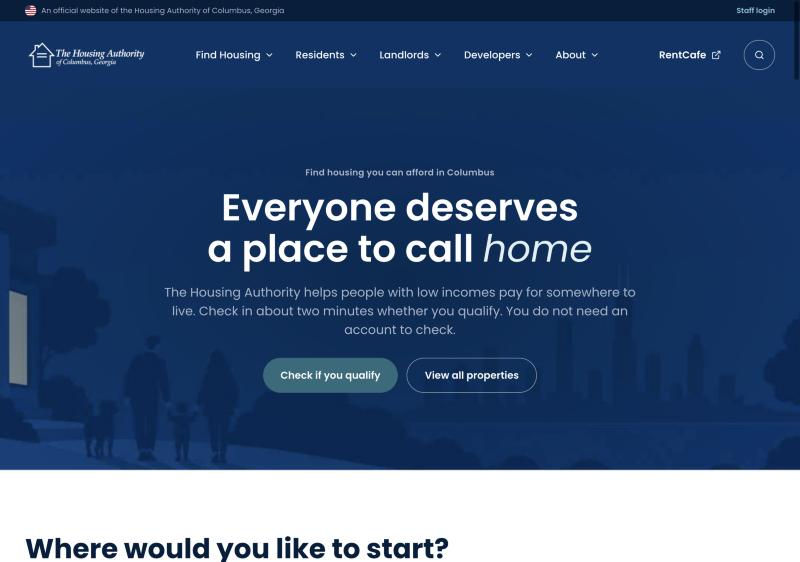
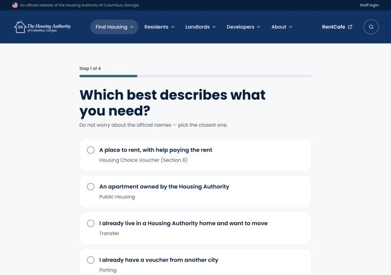
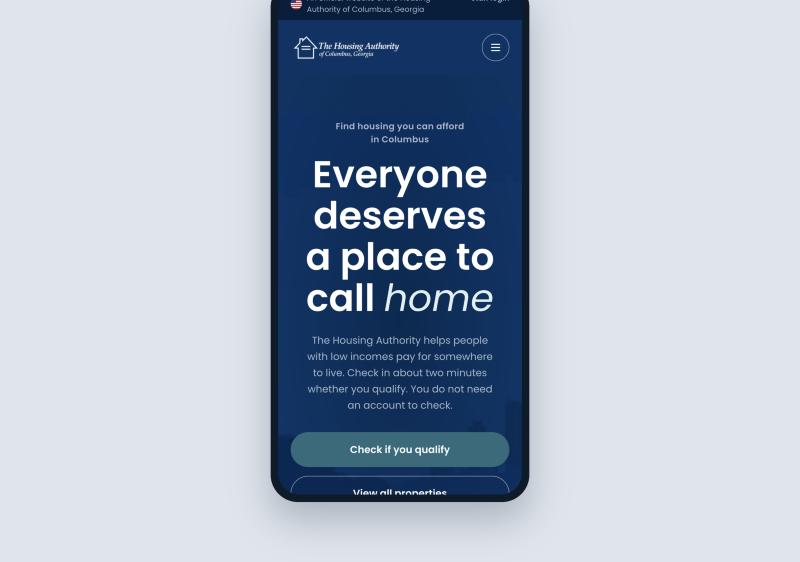

# HACG Website Prototype

A clickable prototype of the website for **The Housing Authority of Columbus, Georgia** — a
public agency that helps people on low incomes pay for housing.

Built as a presale concept: something the client could open in a browser, click through and
react to, instead of a deck of static screens.



🔗 **[Live prototype](https://columbus.trinetix.workers.dev/)** — password protected, access on request

---

## The design problem

People who reach a housing authority website are usually under pressure: rent they cannot
cover, a lease ending, a move they did not choose. What meets them is vocabulary written for
administrators — *Housing Choice Voucher*, *Section 8*, *Project-Based Voucher*, *Porting*,
*Transfer*. None of it answers the question they actually arrived with.

The prototype is an answer to one question: **how fast can someone find out whether this
agency can help them, and what to do next?**

### Plain language first, official name second



Each option leads with what the person wants, and carries the official program name
underneath as a quiet subtitle. *"A place to rent, with help paying the rent"* comes first;
*Housing Choice Voucher (Section 8)* sits below it, so the term is learned in passing rather
than demanded up front.

The check is four steps, needs no account, and collects no personal details — stated plainly
on the button that starts it, because people who have been asked for documents all week are
right to be wary of a form.

### Four doors instead of one menu

The home page opens with four starting points — *I need housing*, *I have housing*, *I rent
out property*, *Board and vendors* — rather than a navigation bar that assumes you already
know which department you need. A landlord and an applicant want opposite things from the
same site; each gets a door of their own.

### Built for the phone



This audience reaches public services on a phone far more often than on a desktop. The
layout is driven by **container queries**, not breakpoints — the same components reflow from
a 1200px page to a 390px screen by responding to the space they are given. The whole
prototype contains a single `@media` rule and five `@container` rules.

A built-in Desktop / Phone toggle lets a stakeholder compare both on one screen during a
review call, without resizing anything or being handed a second link.

### Design file

The full design — flows, states, components and the screens that never made it into the
prototype — lives in Figma:

**[Columbus Website — Figma file](https://www.figma.com/design/goTQdcG9hRd9gyFTAHmWEM/Columbus-Website?node-id=1-943)**

## Accessibility

Treated as part of the design rather than an audit afterwards — which matters more than usual
for a public agency serving older and lower-income residents:

- 55 `aria-label`, 27 `role`, 18 `aria-expanded`, 10 `aria-current` and 7 `aria-live` regions
- 21 `:focus-visible` styles — every interactive element is reachable and visible by keyboard
- `prefers-reduced-motion` respected
- Semantic headings and an explicit document language

## How it is built

**No framework, no build step, no dependencies.** One HTML file: markup, styles and logic
together, images inlined as base64. It opens by double-clicking it, and it will still open in
five years.

That is a deliberate choice for a presale prototype — it travels as a single artefact, needs
no install to review, and nothing in the toolchain can rot before the client has answered.

Routing between screens is hand-rolled on `history.replaceState` and `location.hash`, so the
back button and deep links behave as expected without a router.

### Password protection

The prototype is client work that is not public, so it sits behind a Cloudflare Worker:

- the Worker runs **before** any asset (`run_worker_first`) — nothing in `public/` is served
  without a valid session
- the password screen is **bundled into the Worker**, never exposed as a public file
- sessions are HMAC-SHA256 signed cookies, 24 hours, keyed on a server-side secret; changing
  the password invalidates every existing session through a password fingerprint
- 5 login attempts per minute per IP, via a Cloudflare rate limiter
- secrets live only as encrypted Cloudflare secrets — `scripts/deploy.sh` asks for the
  password at deploy time, generates the session key, uploads both and deletes the temp file

```
src/worker.js      login, signed session cookie, rate limiting, asset protection
src/login.html     the password screen, bundled into the Worker
public/index.html  the prototype itself
scripts/deploy.sh  first deployment, with both secrets
```

## Running it locally

```bash
npm install
cp .dev.vars.example .dev.vars   # then set a local password
npm run dev
```

To see the prototype on its own, without the password gate, open `public/index.html`
directly in a browser.

## Deploying

```bash
npx wrangler login
npm run deploy:secure   # first deployment: uploads both secrets
npm run deploy          # later updates: secrets are kept
npm run check           # build check, uploads nothing
npx wrangler rollback   # back to the previous version
```

---

**Role:** design and build — UX, UI, front-end implementation, deployment.
**Stack:** HTML, CSS (container queries), vanilla JavaScript, Cloudflare Workers.
